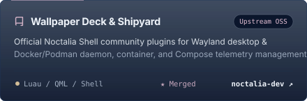
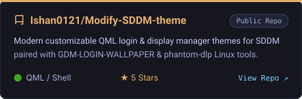
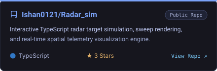

<!-- Full-Bleed Animated Hero Banner (Spring Night Hybrid Canvas) -->

 

<!-- Editorial Minimal Navigation Strip -->

  
  
  
  
  
  

<!-- Minimal Telemetry Indicators -->

  
  
  

### `01` // PROFILE & ENGINEERING ORIENTATION

CS undergraduate from India, building across web, AI, Linux, and embedded systems. Currently pursuing **B.Sc. in Computer Science** at Vidyasagar University (*Debra Thana Sahid Kshudiram Smriti Mahavidyalaya*, 2023–2027).

- **Full-Stack & 3D Web:** Crafting modern reactive interfaces and interactive WebGL experiences — [Portfolio](https://ishan0121.vercel.app/) · [3D Lab](https://ishan0121.vercel.app/3d)
- **Local-First AI & Agents:** Exploring privacy-centric LLM workflows and modular voice assistants ([Aisha](https://ishan0121.vercel.app/about)).
- **Linux & Systems:** Arch/Wayland desktop customization, upstream [Noctalia plugins](https://github.com/noctalia-dev/community-plugins/pulls), and embedded hardware.

### `02` // SELECTED REPOSITORIES & ARCHITECTURES

<table border="0" cellspacing="12" cellpadding="0">
  <tr>
    <td align="center" width="50%">
      
    </td>
    <td align="center" width="50%">
      
    </td>
  </tr>
  <tr>
    <td align="center" width="50%">
      
    </td>
    <td align="center" width="50%">
      
    </td>
  </tr>
  <tr>
    <td align="center" width="50%">
      
    </td>
    <td align="center" width="50%">
      
    </td>
  </tr>
</table>

  
  &nbsp;
  

### `03` // TECHNICAL STACK & TOOLING MATRIX

| Category | Technologies &amp; Tools |
| :--- | :--- |
| **Systems, Embedded &amp; Core** |  |
| **Web, Frontend &amp; 3D Lab** |  |
| **Linux, Shells &amp; Compositors** |  |
| **Databases, Infra &amp; DevOps** |  |
| **Editors, 3D &amp; Workflow** |  |

### `04` // LIVE GITHUB TELEMETRY

<table border="0" cellspacing="8" cellpadding="0">
  <tr>
    <td align="center" valign="middle">
      
    </td>
    <td align="center" valign="middle">
      
    </td>
  </tr>
</table>

 

### `05` // VERIFIED TROPHIES & CERTIFICATIONS

<!-- GitHub Trophies (Restrained Flat Zen Theme) -->

  

<table border="0" cellspacing="8" cellpadding="8">
  <tr>
    <td align="left">
      <strong>IBM SkillsBuild:</strong> <em>From Learner to Builder: Become an AI Agent Architect</em>
    </td>
    <td align="left">
      <strong>IBM SkillsBuild:</strong> <em>Getting Started with Artificial Intelligence</em>
    </td>
    <td align="left">
      <strong>NASSCOM:</strong> <em>Digital 101 Journey</em>
    </td>
  </tr>
</table>

### `06` // CONTRIBUTION ACTIVITY & REPO STREAM

<!-- Daily Activity Line Graph -->

  

<!-- Contribution Snake (Sakura & Midnight Palette) -->
<picture>
  <source media="(prefers-color-scheme: dark)" srcset="assets/github-snake-dark.svg" />
  <source media="(prefers-color-scheme: light)" srcset="assets/github-snake.svg" />
  
</picture>

### `07` // CONNECT & COLLABORATE

  
Whether discussing local-first AI architectures, Linux/Wayland workflows, 3D WebGL experiments, or open-source collaborations:

  

    <a href="https://ishan0121.vercel.app/"><strong>🌐 ishan0121.vercel.app</strong></a> &nbsp;•&nbsp;
    <a href="https://ishan0121.vercel.app/3d"><strong>🧊 3D WebGL Lab</strong></a> &nbsp;•&nbsp;
    <a href="https://ishan0121.vercel.app/about"><strong>📖 Engineering Journey</strong></a> &nbsp;•&nbsp;
    <a href="https://www.linkedin.com/in/ishan-maiti-785212297"><strong>💼 LinkedIn</strong></a> &nbsp;•&nbsp;
    <a href="https://orcid.org/0009-0001-9389-807X"><strong>🔬 ORCID</strong></a> &nbsp;•&nbsp;
    <a href="mailto:ishanmaiti1234@gmail.com"><strong>✉️ ishanmaiti1234@gmail.com</strong></a>
  

<!-- Atmospheric Spring Night Footer SVG -->

