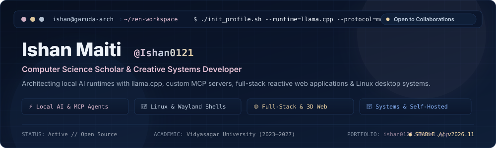
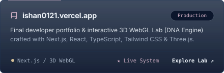
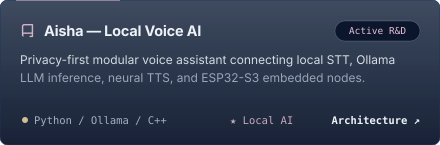
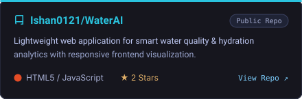

<!-- Custom Self-Contained Hero Banner SVG (Zero external API downtime) -->

 

<!-- Primary Portfolio, 3D Lab & Social Navigation Bar -->

  
  
  
  
  
  

  
  
  

---

## ⚡ About Me

CS undergraduate from West Bengal, India, building across web, AI, Linux, and systems.

- **Full-stack & Web:** Crafting modern web experiences — [Portfolio](https://ishan0121.vercel.app/) · [3D Lab](https://ishan0121.vercel.app/3d)
- **AI & Agents:** Exploring local-first LLM workflows and voice-assistant projects (Aisha).
- **Linux & Systems:** Wayland/desktop customization, open-source contributions, and self-hosted infrastructure.

---

## 🚀 Featured Work

<table>
  <tr>
    <td align="center" width="50%">
      
    </td>
    <td align="center" width="50%">
      
    </td>
  </tr>
  <tr>
    <td align="center" width="50%">
      
    </td>
    <td align="center" width="50%">
      
    </td>
  </tr>
  <tr>
    <td align="center" width="50%">
      
    </td>
    <td align="center" width="50%">
      
    </td>
  </tr>
</table>

 

<strong>Want to see more?</strong> Explore my repositories, experiments, and open-source activity directly on GitHub and my portfolio.

  
  

---

## 📊 Live GitHub Analytics

  
  

   

  

    

  

---

## 🧰 Technical Stack & Tooling

| Category | Technologies & Tools |
| :--- | :--- |
| **Systems, Embedded & Core** |  |
| **Web, Frontend & 3D Lab** |  |
| **Linux, Shells & Compositors** |  |
| **Databases, Infra & DevOps** |  |
| **Editors, 3D & Workflow** |  |

---

## 🐍 Contribution Snake

  <picture>
    <source media="(prefers-color-scheme: dark)" srcset="assets/github-snake.svg" />
    <source media="(prefers-color-scheme: light)" srcset="assets/github-snake.svg" />
    
  </picture>
  
<em>Auto-updated visual of contribution activity.</em>

---

  <h3>🤝 Let's Build Something Meaningful Together</h3>
  
Whether it's a local-first AI system, a Linux desktop tool, a web experiment, or an open-source collaboration — feel free to reach out!

  

    <a href="https://ishan0121.vercel.app/"><strong>🌐 ishan0121.vercel.app</strong></a> •
    <a href="https://ishan0121.vercel.app/3d"><strong>🧊 3D Lab</strong></a> •
    <a href="https://www.linkedin.com/in/ishan-maiti-785212297"><strong>💼 LinkedIn</strong></a> •
    <a href="mailto:ishanmaiti1234@gmail.com"><strong>✉️ ishanmaiti1234@gmail.com</strong></a>
  

