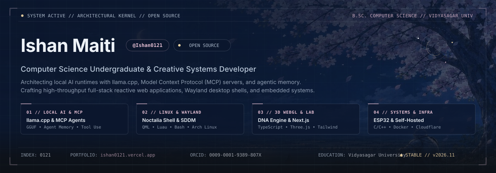
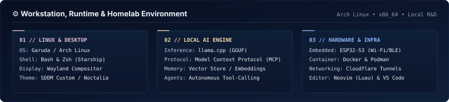

<!-- ========================================== -->
<!-- HERO BANNER [COMP-01 // Primary Active: Variant A] -->
<!-- ========================================== -->

 

<!-- ========================================== -->
<!-- QUICK NAVIGATION STRIP [COMP-02 / NAV-01] -->
<!-- ========================================== -->

  
  
  
  
  
  

<!-- ========================================== -->
<!-- MINIMAL LIVE TELEMETRY PILLS [COMP-03 / IND-01] -->
<!-- ========================================== -->

  
  
  
  

### `01` // PROFILE & CS ORIENTATION

  B.Sc. Computer Science undergraduate at <strong>Vidyasagar University</strong> (2023–2027). 
  Engineering local AI inference runtimes, Linux desktop systems, reactive web architectures, and embedded computing.

  <code>llama.cpp</code> &nbsp;•&nbsp; <code>Model Context Protocol (MCP)</code> &nbsp;•&nbsp; <code>Arch Linux / Wayland</code> &nbsp;•&nbsp; <code>Three.js / React</code> &nbsp;•&nbsp; <code>ESP32-S3</code>

 

<!-- Workstation & Environment Specs [SPEC-01] -->

  

 

### `02` // TECHNICAL STACK & TOOLING MATRIX

<!-- Tech Stack Design Variant A: Interactive SkillIcons Categorized Grid [COMP-07-VAR-A / STACK-01] -->

| Category | Technologies &amp; Tools |
| :--- | :--- |
| **Local AI, Agents &amp; ML** |  |
| **Web, Frontend &amp; 3D Lab** |  |
| **Systems, Embedded &amp; Core** |  |
| **Linux, Shells &amp; Compositors** |  |
| **Databases, Infra &amp; DevOps** |  |
| **Editors, 3D &amp; Productivity** |  |

 

  
  
  
  
  
  
  
  
  
  
  
  
  

 

### `03` // LIVE GITHUB TELEMETRY & STATS

<!-- GitHub Stats & Streak Pair [COMP-08 / TEL-01 & TEL-02] -->
<table border="0" cellspacing="8" cellpadding="0">
  <tr>
    <td align="center" valign="middle">
      
    </td>
    <td align="center" valign="middle">
      
    </td>
  </tr>
</table>

 

 

<!-- Daily Activity Area Graph [COMP-11 / TEL-05] -->

### `04` // CONTRIBUTION STREAM

<!-- Contribution Snake (Sakura & Midnight Palette) [COMP-16 / SNAKE-01] -->
<picture>
  <source media="(prefers-color-scheme: dark)" srcset="assets/github-snake-dark.svg" />
  <source media="(prefers-color-scheme: light)" srcset="assets/github-snake.svg" />
  
</picture>

### `05` // CONNECT & COLLABORATE

  
Let's connect.

  
  

    <a href="https://ishan0121.vercel.app/"><strong>Portfolio</strong></a> &nbsp;•&nbsp;
    <a href="https://ishan0121.vercel.app/3d"><strong>3D Lab</strong></a> &nbsp;•&nbsp;
    <a href="https://www.linkedin.com/in/ishan-maiti-785212297"><strong>LinkedIn</strong></a> &nbsp;•&nbsp;
    <a href="https://orcid.org/0009-0001-9389-807X"><strong>ORCID</strong></a> &nbsp;•&nbsp;
    <a href="mailto:ishanmaiti1234@gmail.com"><strong>Email</strong></a>
  

 

<!-- Atmospheric Spring Night Footer SVG [COMP-17 / FOOTER-01] -->

 
